<div align="center">

# DhanVeda

### An empirical study of a multi-provider LLM platform for Indian retail investors

*Five-tier LLM routing · rule-preserving prompt compression · India-calibrated scoring · seeded, reproducible experiments*

[](https://arthasift.vercel.app)
[](docs/research-report.pdf)


</div>

| | |
|---|---|
| 🌐 **Live demonstration** | [arthasift.vercel.app](https://arthasift.vercel.app) |
| 📄 **Research report (PDF, 42 pp.)** | [`docs/research-report.pdf`](docs/research-report.pdf) |
| 📐 **Technical documentation** | [Methodology](docs/methodology.md) · [System architecture](docs/system-architecture.md) · [Literature review](docs/literature-review.md) |
| 📊 **Experiment outputs** | [`experiments/results/`](experiments/results) · [`figures/`](figures) · [run config](experiments/configs/experiments.json) |
| 🗂️ **Data and generators** | [Data card](data/data-card.md) · [`experiments/`](experiments) · [`reproduce.sh`](reproduce.sh) |
| 📚 **Citation** | [`CITATION.cff`](CITATION.cff) · [BibTeX](#citation) |

---

## Key findings at a glance

| # | Finding | Evidence |
|---|---------|----------|
| 1 | Rule-preserving prompt compression cut the core analysis prompt by **56.9%** (3,645 → 1,571 tokens) without dropping a single scoring rule | E1 |
| 2 | The platform's `chars / 4` token estimator **undercounts number-dense prompts by up to 34.2%** | E1 |
| 3 | Sector alone explains **96.4%** of ESG composite variance (η² = 0.964) | E2 |
| 4 | **247 of 532** securities (46.4%, 95% CI 42.2–50.7%) change ESG tier under a one-point governance shift | E3 |
| 5 | At 10% retrieval noise, **62.4%** of companies change verdict band across ten runs (mean SD 3.71 pts) | E6 |
| 6 | A company at the Indian median on every KPI scores **68**, while the simulated population median is **39**; the rubric's stated anchor is 50 | E5 |
| 7 | Cascade availability reaches **99.990%** at a 10% per-tier failure rate, assuming independent failures | E7 |

**Hypothesis scorecard:** 2 supported · 4 rejected · 1 awaiting a live trial (fully specified). Negative results are reported as they came out; the decision rules were fixed before any script ran.

---

## Contents

1. [Project overview](#1-project-overview)
2. [Problem statement](#2-problem-statement)
3. [Research objectives](#3-research-objectives)
4. [Literature review](#4-literature-review)
5. [Proposed methodology](#5-proposed-methodology)
6. [System architecture](#6-system-architecture)
7. [Experimental setup](#7-experimental-setup)
8. [Results](#8-results)
9. [Statistical analysis](#9-statistical-analysis)
10. [Reproducibility](#10-reproducibility)
11. [Limitations](#11-limitations)
12. [Future work](#12-future-work)

---

## 1. Project overview

DhanVeda (deployed as **ArthaSift**) is an AI decision-support platform for Indian retail investors. It has **14 AI-assisted features** across five areas:

- **Equity research:** 14-KPI analysis with a DV Score, ESG deep dive, transcript analyser.
- **Decision hygiene:** thesis tester, bias checker, conviction journal.
- **Green finance:** ESG screener, carbon and RECs, rooftop solar, REITs.
- **Portfolio review.**
- **Venture analysis.**

Every AI call is routed through a **five-tier hierarchy of LLM providers** that keeps the marginal cost close to zero. A rule-based **ESG engine** scores a universe of **532 NSE/BSE securities**.

This repository presents the platform as a research artefact. It contains the full application source and a reproducible experimental harness. That harness ran more than **5.4 million scoring operations** to test whether the design does what it claims.

## 2. Problem statement

Indian retail participation has grown much faster than retail outcomes:

- The NSE reported **12.7 crore unique investors** and **more than 25 crore trading accounts** by January 2026 [1].
- A SEBI study found that **93% of individual F&O traders lost money** between FY22 and FY24 [2].

The data is free. Interpreting it is the hard part. A retail investor has to know, for example:

- that a P/E of 45 is moderate for FMCG but extreme for metals;
- that heavy promoter pledging has come before several collapses;
- what it means when a price falls below its 200-day moving average.

LLMs can explain these points in plain language, but they have three properties that make them hazardous for this job:

- they **fabricate figures**;
- they **vary between runs even at temperature 0**;
- they default to **US benchmarks**.

DhanVeda wraps a general model in three layers to contain these problems: an India-calibrated rubric, a provider hierarchy, and deterministic algorithms wherever judgement isn't needed. **Each layer makes a measurable claim, and this project measures them.**

## 3. Research objectives

| ID | Question |
|----|----------|
| **RQ1** Efficiency | Can a free-tier, multi-provider hierarchy serve a rubric-heavy financial analysis within published rate limits? |
| **RQ2** Tokenization | How accurate is the platform's token accounting, and what drives token cost? |
| **RQ3** ESG validity | Does the ESG engine distinguish between companies, or mostly restate sector membership? |
| **RQ4** Robustness | How sensitive are ESG tiers and DV bands to small input errors? |
| **RQ5** Calibration | Does the DV rubric produce the distribution its own anchors claim? |
| **RQ6** Reliability | How often does a request fail outright, or get answered by an unintended model? |

## 4. Literature review

Full version: [`docs/literature-review.md`](docs/literature-review.md).

| Approach | Limitation | How DhanVeda responds |
|----------|-----------|-----------------------|
| Domain-trained LLMs (BloombergGPT [3]) | Training budget far beyond a retail platform | Prompt a general model with an explicit, auditable rubric |
| Retrieval-augmented QA (FinanceBench [5]) | GPT-4-Turbo with retrieval wrong or refused on **81%** of questions | **Separate retrieval from scoring** (Gemini retrieves, Groq scores) |
| "Deterministic" decoding [6] | Accuracy swings of up to 15% at temperature 0 | Treat each score as a sample; measure the spread (E6, P1) |
| Learned routers (FrugalGPT [7], RouteLLM [8]) | Need preference or quality training data | **Failure-driven cascade** that needs no training data |
| Statistical prompt pruning (LLMLingua [9]) | Can silently delete rules | **Rule-preserving** manual compression |
| Global ESG ratings [11] | Agencies correlate only 0.38–0.71; thin coverage of Indian small-caps | Transparent rules based on SEBI pledge and BRSR signals |

**Open gap:** no score has yet been validated against market outcomes. See [future work](#12-future-work).

## 5. Proposed methodology

Full version: [`docs/methodology.md`](docs/methodology.md).

Seven hypotheses were **pre-registered**, with numeric decision rules, before any experiment ran:

| ID | Hypothesis | Decision rule | Test |
|----|------------|---------------|------|
| H1 | Compression cuts tokens by ≥ 50% and one call fits in 6,000 TPM | Δ ≥ 50% and prompt + 2,500 < 6,000 | E1 |
| H2 | Compressed and full rubrics agree | Mean \|Δ\| ≤ 3 pts, paired p > 0.05 | P1 (live) |
| H3 | Repeated runs are stable | SD ≤ 2 and band unchanged in ≥ 90% | E6 |
| H4 | The ESG composite carries signal beyond sector | Sector η² < 0.80 | E2 |
| H5 | ESG tiers are robust to a 1-point G error | ≤ 10% change tier | E3 |
| H6 | An all-median company scores about 50 | 50 ± 5 | E5 |
| H7 | The cascade reaches ≥ 99.9% availability | 1 − ∏p ≥ 0.999 at p = 0.10 | E7 |

**Experiment documentation**

- **Independent variables:**
  - prompt variant;
  - tokenizer;
  - promoter pledge and holding;
  - retrieval noise σ ∈ {0, 5, 10, 15, 20, 30}%;
  - per-tier failure rate ∈ {5, 10, 20, 30}%.
- **Dependent variables:**
  - token count and estimator error;
  - ESG tier and composite;
  - DV Score and verdict band;
  - availability.
- **Controls:**
  - the unmodified scoring code (verified by SHA-256);
  - fixed seeds (`20261025`, `7`);
  - a fixed test stock for prompt extraction.
- **Baselines:**
  - the uncompressed rubric and the code's own `chars/4` estimator;
  - a sector-only ESG model;
  - the noise-free score;
  - a single-provider route.
- **Repetitions:**
  - 10,000 Monte Carlo draws;
  - 20,000 synthetic companies;
  - 10 repeated runs × 1,000 companies × 6 noise levels.
- **Analysis:** mean, SD, t-based 95% CIs, Wald CIs, order-statistic CIs, η² effect sizes and sensitivity sweeps.

## 6. System architecture

Full version: [`docs/system-architecture.md`](docs/system-architecture.md).

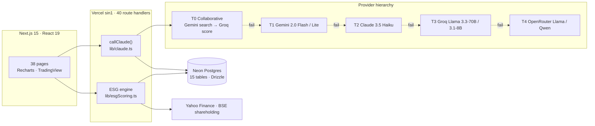

<p align="center">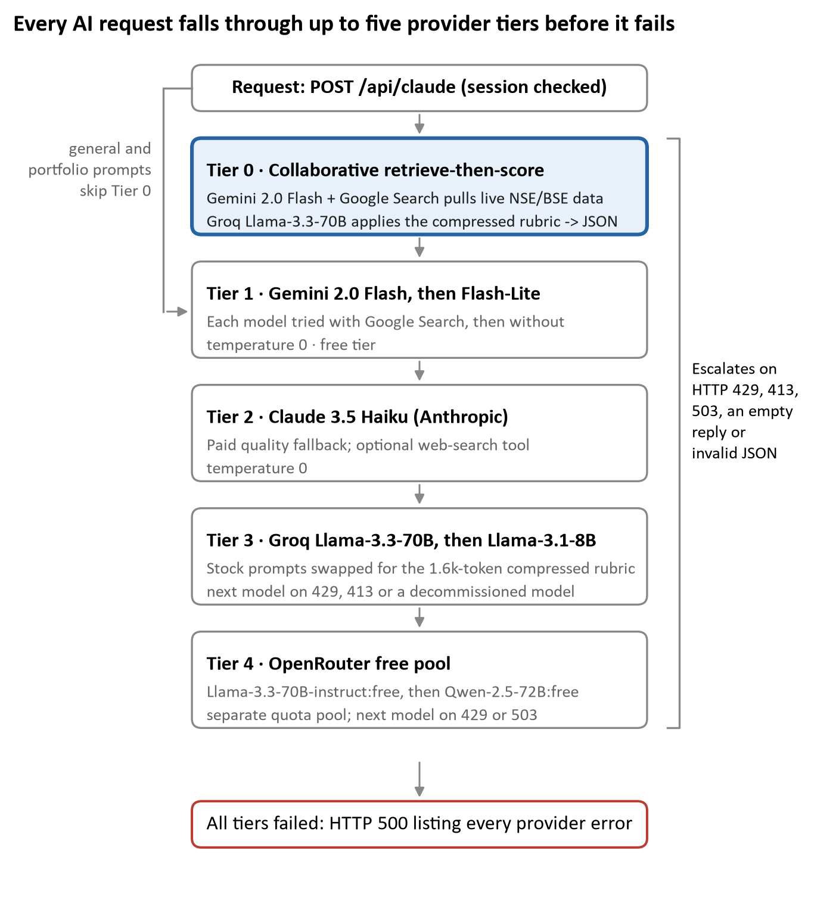</p>

**The token problem and its fix.**

- Groq's free tier allows **6,000 tokens per minute**. A full analysis call needs **3,645 prompt tokens + 2,500 reserved = 6,145**, which doesn't fit.
- `buildGroqPrompt()` rewrites the rubric in telegraphic form. It keeps every threshold and point value and drops only the explanatory prose:

  ```text
  "+7 ROE >= 20% (top-quartile Indian company, well above Nifty avg 14-16%)"  →  "ROE/7: >=20%=+7"
  ```

## 7. Experimental setup

| Item | Value |
|------|-------|
| **Datasets** | D1: 13 production prompts extracted from the source · D2: 532-security universe (`lib/stockSeed.ts`) · D3: 20,000 simulated companies ([data card](data/data-card.md)) |
| **Code under test** | `lib/claude.ts` `272d588a…` · `lib/esgScoring.ts` `fb2756f1…` · `lib/stockSeed.ts` `57680a09…` (SHA-256 prefixes, re-verified at commit time) |
| **Parameters** | [`experiments/configs/experiments.json`](experiments/configs/experiments.json) |
| **Environment** | Node 24.19.0 (native TypeScript type-stripping) · Python 3.14.6 · tiktoken 0.14.0 · matplotlib 3.11.2 · Windows 10 Pro |
| **Hardware** | A single consumer laptop. The full suite runs in about 6 seconds, with no GPU and no API calls |
| **Ethics** | Offline only: no user data was read and no API quota was used |

| ID | Experiment | Iterations |
|----|------------|-----------:|
| E1 | Token audit: 13 prompts × 2 BPE tokenizers | deterministic |
| E2 | ESG engine over 532 securities without BSE data | deterministic |
| E3 | ±1 G-point shock on every security | 1,064 |
| E4 | Monte Carlo of pledge and holding uncertainty | 5,320,000 |
| E5 | DV-rubric population simulation | 20,000 |
| E6 | Repeated-run retrieval-noise trial | 60,000 |
| E7 | Cascade availability (analytic) | 4 × 2 |
| P1 | *Live trial, specified:* 30 stocks × 2 prompts × 5 runs × 3 days | 900 calls |

## 8. Results

### 8.1 Token engineering (E1): **H1 supported**

<p align="center">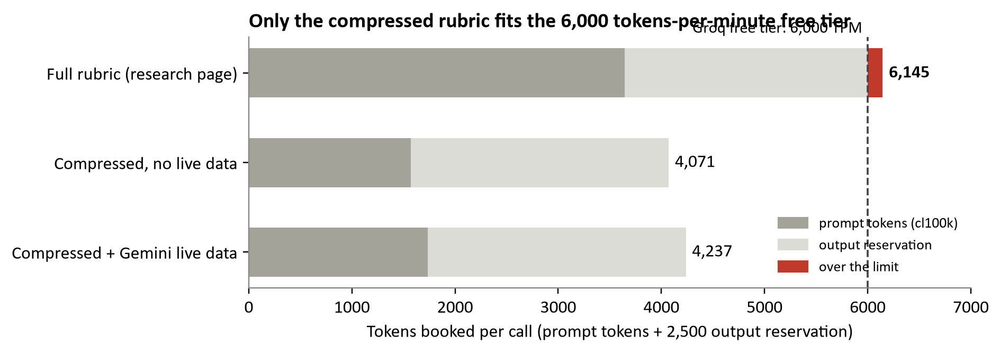</p>

| Prompt variant | Characters | cl100k | o200k | Δ vs full |
|----------------|-----------:|-------:|------:|----------:|
| Full rubric | 12,269 | 3,645 | 3,618 | — |
| Compressed | 4,137 | **1,571** | 1,575 | **−56.9%** |
| Compressed + live data | 4,776 | 1,737 | 1,739 | −52.3% |

The `chars / 4` heuristic is badly wrong on threshold-heavy text, because digits, `%`, `>=` and `|` each become separate tokens:

<p align="center">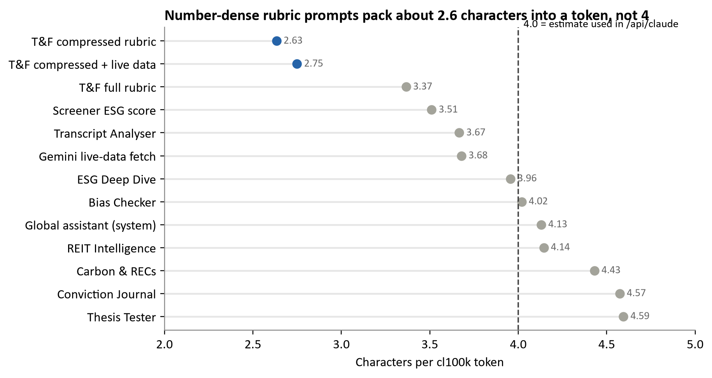</p>

| Prompt | Actual (cl100k) | `chars/4` estimate | Error |
|--------|---------:|---------:|------:|
| Compressed rubric | 1,571 | 1,034 | **−34.2%** |
| Full rubric | 3,645 | 3,067 | −15.9% |
| Thesis Tester (plain prose) | 355 | 408 | +14.9% |

### 8.2 ESG engine (E2–E4): **H4 and H5 rejected**

<table><tr>
<td>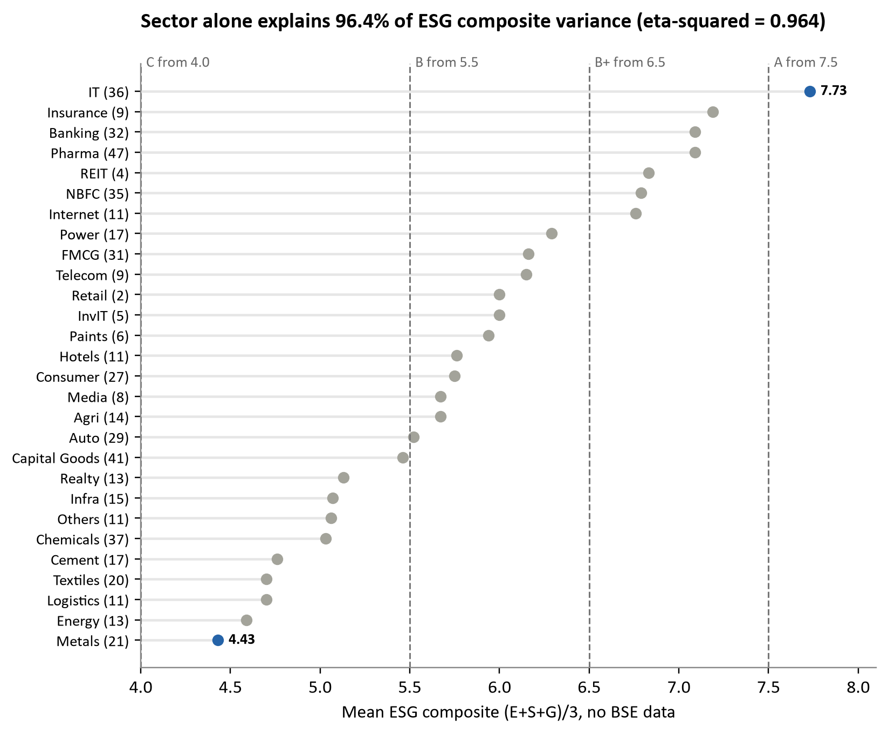</td>
<td>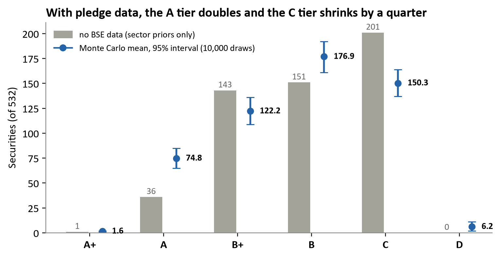</td>
</tr></table>

- **Sector explains 96.4% of the variance** in the ESG composite. Only 16 of 532 securities have a company-specific override, so for the other 97% the E and S scores are set entirely by sector.
- **Governance data shifts the tier distribution.** Tier A grows from 36 to **74.8** (95% interval 65–85), tier C shrinks from 201 to 150.3, and tier D appears only once pledge data exist.
- **Tier assignments are unstable.** Only 81 securities (15%) keep the same tier in at least 90% of Monte Carlo draws.

<table><tr>
<td>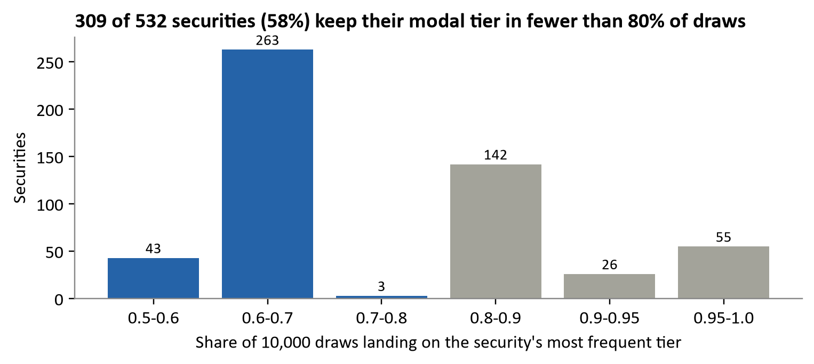</td>
<td>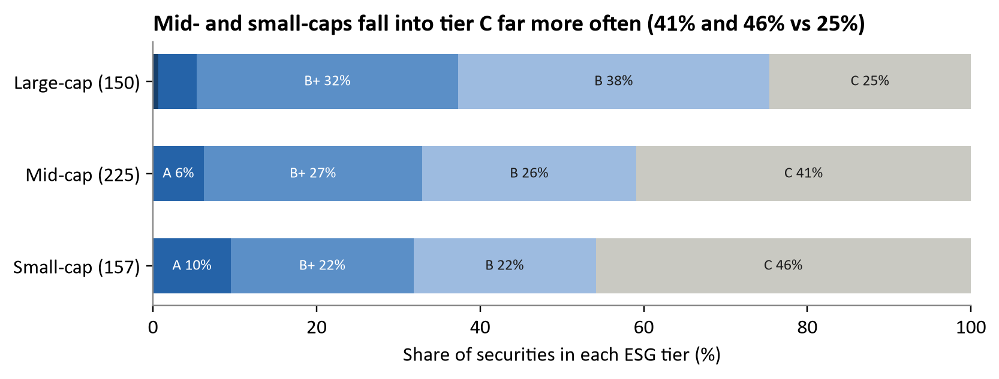</td>
</tr></table>

### 8.3 DV Score calibration (E5): **H6 rejected**

<p align="center">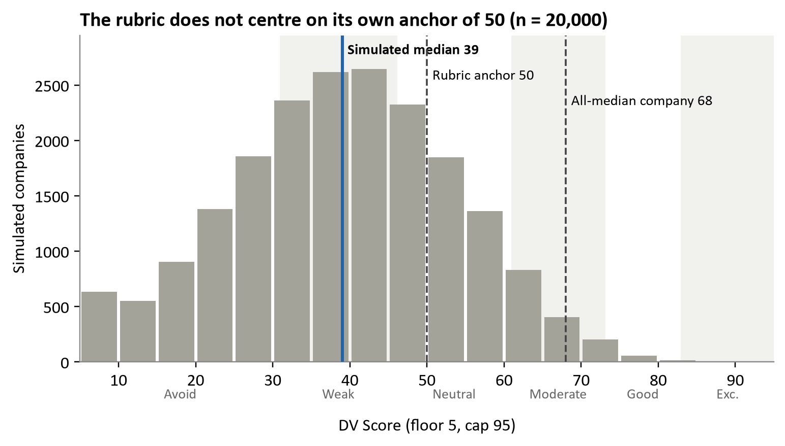</p>

- A company at the Indian median on every KPI scores **68**, not 50. The technical block alone swings the score by ±8.
- The population median is **39** (IQR 29–49), because penalties are asymmetric: up to −8 per metric and −52 in combined deductions.
- The compressed rubric leaves ranges with no rule:
  - P/E 15–25% below or 1.6–2.0× above the sector median (19.1% of companies);
  - RSI 30–40 or 65–75 (24.0%);
  - pledge 5–10% (3.0%).

### 8.4 Cascade reliability (E7): **H7 supported (assuming independence)**

<p align="center">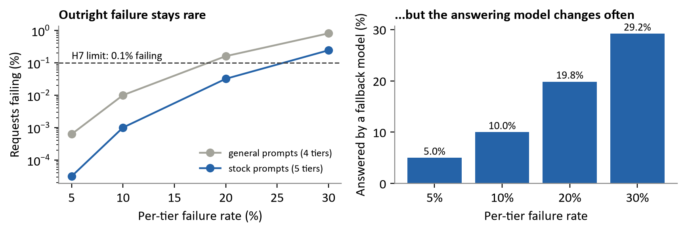</p>

| Per-tier failure | Availability, general (4 tiers) | Availability, stock (5 tiers) | Answered by a fallback model |
|-----:|------:|------:|------:|
| 5% | 99.9994% | 99.99997% | 5.0% |
| 10% | **99.990%** | 99.999% | 10.0% |
| 20% | 99.84% | 99.97% | 19.8% |
| 30% | 99.19% | 99.76% | 29.2% |

The cascade rarely fails outright, but **on a busy day 20–30% of answers come from a different model**, and that model may interpret the rubric differently (§8.3).

### 8.5 Summary of effect sizes

| Comparison | Baseline | Treatment | Effect |
|------------|---------:|----------:|-------:|
| Prompt tokens, full vs compressed | 3,645 | 1,571 | −56.9% |
| Token estimator on compressed rubric | 1,571 actual | 1,034 estimated | −34.2% error |
| A-tier count, no data vs Monte Carlo | 36 | 74.8 | +108% |
| Sector share of ESG variance | — | η² = 0.964 | very large (> 0.14) |
| DV band changes at 10% noise | 0% (noise-free) | 62.4% | — |

## 9. Statistical analysis

### Repeated-run variability (E6): **H3 not supported**

Each of 1,000 synthetic companies was scored once without noise and then 10 more times, with every continuous metric multiplied by (1 + ε), where ε ~ N(0, σ).

<table><tr>
<td>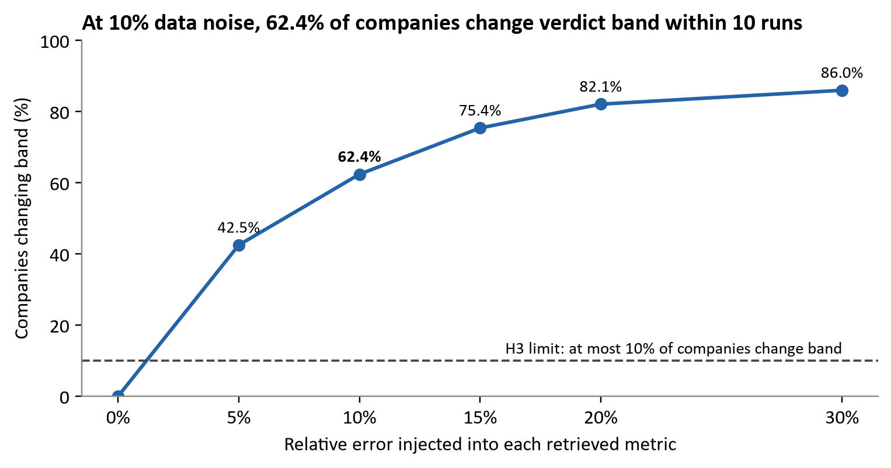</td>
<td>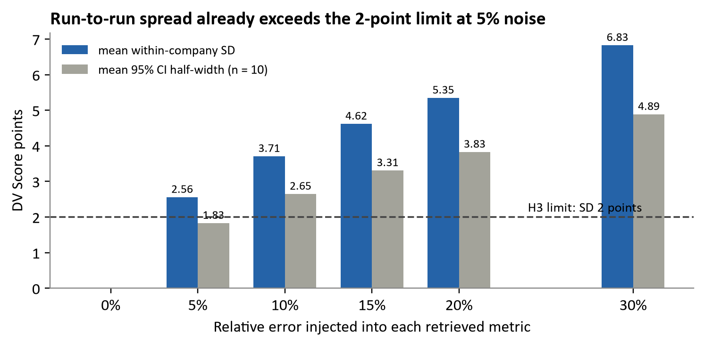</td>
</tr></table>

| Noise σ | Mean SD (pts) | 95% CI half-width | Median \|dev\| | P90 \|dev\| | Band-flip share |
|------:|------:|------:|---:|---:|------:|
| 5% | 2.56 | 1.83 | 2 | 6 | 42.5% |
| 10% | **3.71** | 2.65 | 3 | 8 | **62.4%** |
| 15% | 4.62 | 3.31 | 4 | 10 | 75.4% |
| 20% | 5.35 | 3.83 | 4 | 11 | 82.1% |
| 30% | 6.83 | 4.89 | 6 | 14 | 86.0% |

- **Even 5% noise breaks H3.** The step-function rubric causes this: ROE 19.9% earns +5 while 20.0% earns +7.
- **Spread grows sub-linearly.** SD rises 2.7× while σ rises 6×, because most metrics sit well inside a bucket.

### Precision of estimates

| Quantity | Method | Result |
|----------|--------|--------|
| E3 tier-flip rate | Wald 95% CI on 247/532 | **46.4% [42.2%, 50.7%]** |
| E4 proportions | Monte Carlo SE, √(0.25/10⁴) | ≤ 0.5 pp |
| E5 median | Order-statistic CI (ranks 9,861 and 10,139 of 20,000) | **39 [39, 39]** |
| P1 sample size | Paired, α = 0.05, power 0.80, σ<sub>Δ</sub> = 5, δ = 3 | n = 22; **30 planned** |
| P1 reliability | ICC(2,1) | acceptance at ≥ 0.9 |

### Hypothesis outcomes

| ID | Outcome | Evidence |
|----|---------|----------|
| H1 | ✅ Supported | −56.9%; 4,071–4,237 vs 6,145 tokens per call |
| H2 | ⏳ Not yet tested | Live trial P1 specified |
| H3 | ❌ Not supported (simulated) | SD 2.56 and 42.5% band changes at only 5% noise |
| H4 | ❌ Rejected | η² = 0.964 |
| H5 | ❌ Rejected | 46.4% (95% CI 42.2–50.7%) |
| H6 | ❌ Rejected | All-median company = 68; population median = 39 |
| H7 | ✅ Supported (independent failures) | 99.990% at 10% per-tier failure |

## 10. Reproducibility

Every number and figure above can be regenerated with one command. The outputs are **byte-identical** to the committed files: this was checked by re-running the suite before this commit.

```bash
git clone https://github.com/Icoder05/DhanVeda.git && cd DhanVeda
pip install -r requirements.txt                  # tiktoken, matplotlib
bash reproduce.sh                                # Node 23.6+ required (native TS type-stripping)
git diff --stat experiments/results              # → no changes
```

| Script | Experiments | Seed | Output |
|--------|-------------|------|--------|
| [`extract.js`](experiments/extract.js) → [`tok.py`](experiments/tok.py) | E1 | — | `data/processed/prompts.json`, `results/tokens.json` |
| [`esg_exp.ts`](experiments/esg_exp.ts) | E2–E4 (imports the **unmodified** `lib/esgScoring.ts`) | `20261025` | `results/esg_results.json` |
| [`rubric_exp.js`](experiments/rubric_exp.js) | E5–E6 | `7` | `results/rubric_results.json` |
| [`cascade_exp.py`](experiments/cascade_exp.py) | E7 | — | `results/cascade_results.json` |
| [`report/figs.py`](report/figs.py) | all figures | — | `figures/*.png` |
| [`report/build.py`](report/build.py) | report DOCX (then [`export_pdf.ps1`](report/export_pdf.ps1) through Word) | — | `docs/research-report.*` |

**Running the app locally**

```bash
cd dhanveda-app
cp .env.example .env.local        # fill in Neon, AUTH_SECRET and provider keys
npm install
npm run db:push                   # create tables via Drizzle
npm run dev                       # http://localhost:3000
```

## 11. Limitations

- **E4–E6 use simulated inputs.** Their absolute values depend on the assumed distributions ([data card](data/data-card.md)); the structural conclusions about boundary sensitivity and anchor mismatch do not.
- **The rubric was re-implemented deterministically.** A real LLM may smooth over undefined ranges or misapply rules, which could raise or lower the variance.
- **No live LLM calls, latency measurements or production records** were used, so H2 is untested until P1 runs.
- **E7 assumes independent failures.** Correlated outages, such as cold starts or regional incidents, would lower availability.
- **Gemini's tokenizer was not measured.** cl100k and o200k agree within 2%, but Gemini may differ.
- **No ground truth yet.** DV Scores are not persisted, so they cannot yet be back-tested against returns.

## 12. Future work

Ranked by impact per unit of effort:

1. **Show uncertainty in the UI.** Display the DV Score as score ± 1 SD and flag scores within 3 points of a band edge as borderline.
2. **Label "model memory, not live data"** whenever Tier 0 retrieval fails.
3. **Fix the ESG defects:**
   - apply the BRSR mandate to the top 1,000 companies instead of only large-caps;
   - use `tierBase` as a floor or ceiling;
   - extend `NSE_TO_BSE` beyond its current 30 tickers.
4. **Close the rubric gaps.** Define rules for the P/E, RSI and pledge ranges that have none, and re-anchor the bands to the observed distribution.
5. **Add an `ai_runs` table** that logs the provider, model, latency, real token usage and output for every call (schema in report §6.5).
6. **Run live trial P1** (900 calls) to test H2 and H3 against real models, using ICC(2,1) for test-retest reliability.

Research directions:

- **Outcome validation:** test whether DV bands predict 6- and 12-month excess returns over the Nifty 500.
- **Quality-aware routing:** escalate on rubric-consistency checks rather than only on failure, in the spirit of RouteLLM [8].
- **Smooth scoring:** replace step functions with piecewise-linear interpolation to reduce boundary effects.
- **Learned ESG signals:** extract evidence from BRSR filings and compare it with global rating agencies.
- **Indic-language cost:** measure tokenization cost and answer quality for Hindi, Telugu and Tamil.

---

## Repository structure

```
DhanVeda/
├── docs/
│   ├── research-report.pdf        ← full 42-page report
│   ├── research-report.docx
│   ├── methodology.md
│   ├── system-architecture.md
│   └── literature-review.md
├── data/
│   ├── raw/                       ← literature abstracts (similarity check)
│   ├── processed/                 ← extracted production prompts (D1)
│   └── data-card.md
├── experiments/
│   ├── configs/experiments.json   ← seeds, parameters, hypothesis thresholds
│   ├── results/                   ← JSON outputs of E1–E7
│   ├── logs/                      ← console logs of the last run
│   └── extract.js · tok.py · esg_exp.ts · rubric_exp.js · cascade_exp.py
├── figures/                       ← all 12 report figures
├── report/                        ← figs.py · content.py · build.py · export_pdf.ps1
├── dhanveda-app/                  ← the Next.js 15 application under study
├── reproduce.sh
├── requirements.txt
├── CITATION.cff
└── LICENSE
```

## Citation

```bibtex
@techreport{chitakana2026dhanveda,
  author      = {Chitakana, Kishan Phani},
  title       = {DhanVeda: Research and Experimental Analysis Report --
                 An Evidence-Based Evaluation of a Multi-Provider LLM Platform for Indian Retail Investors},
  year        = {2026},
  month       = oct,
  institution = {GitHub},
  url         = {https://github.com/Icoder05/DhanVeda}
}
```

## Disclaimer

DhanVeda gives educational analysis. It is **not** SEBI-registered investment advice.

## License

[MIT](LICENSE)
